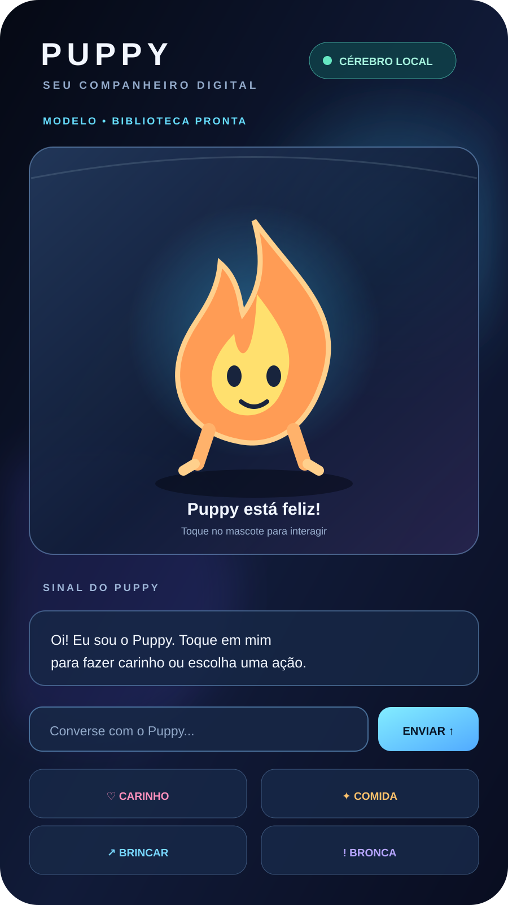

# Puppy — Meu Pet

> Um mascote virtual para Android que simula necessidades, emoções, personalidade e aprendizado por interação.

**Repositório:** https://github.com/karinaosproject/Puppylrk-pet  
**Pacote Android:** `br.karina.pet`  
**Nome exibido:** Puppy  
**Versão declarada:** 0.1

## Visão geral

O Puppy é um pet virtual desenvolvido em Java para Android. O personagem permanece ativo em uma tela própria, movimenta-se, muda de cor conforme seu estado e reage às interações do usuário.

O comportamento é controlado por um modelo simples de rede neural pulsada (neurônios integra-e-dispara), com rastros de elegibilidade e atualização de pesos por recompensa. O projeto também inclui habilidades baseadas em regras para consultar clima, ler manchetes RSS e pesquisar assuntos na Wikipédia.

O processamento comportamental do pet é local. As consultas de clima, notícias e Wikipédia dependem de conexão com a internet.

## Funcionalidades implementadas

| Recurso | Implementação atual |
| --- | --- |
| Mascote animado | Desenho customizado em Canvas, movimento, partículas, órbitas e animação |
| Aparência reativa | Cor e expressão mudam de acordo com emoção e ação |
| Necessidades | Fome e energia evoluem com o tempo |
| Emoções e vínculo | Alegria, raiva e vínculo respondem às interações |
| Interações | Carinho, comida, brincadeira e bronca |
| Comportamento autônomo | Passear, brincar, fazer travessuras, dormir e pedir comida |
| Rede neural | Camadas de entrada, oculta e saída com neurônios integra-e-dispara |
| Aprendizado por recompensa | Ajuste de pesos após consequências próximas a uma travessura |
| Persistência | Estado, personalidade e pesos salvos em SharedPreferences |
| Passagem de tempo | Atualização simplificada das necessidades após o app ficar pausado |
| Diário | Histórico local de até 200 linhas |
| Clima | Consulta Open-Meteo por cidade, com Taubaté como cidade padrão |
| Notícias | Leitura de feeds RSS da BBC Brasil e do G1 |
| Conhecimento | Pesquisa de resumos na Wikipédia em português |
| Build automatizado | GitHub Actions compila o APK debug e publica um artifact |

## Como interagir

Na tela principal, o usuário pode:

- Tocar no mascote para dar carinho.
- Usar os botões **Carinho**, **Comida**, **Brincar** e **Bronca**.
- Digitar comandos na caixa de conversa.
- Abrir o diário pelo botão **Diário** ou pelo comando `diario`.

### Comandos reconhecidos

| Comando / exemplo | Resultado |
| --- | --- |
| `ajuda` | Mostra os comandos disponíveis |
| `clima` | Consulta o clima da cidade salva ou da cidade padrão |
| `clima em Santos` | Consulta o clima de uma cidade informada |
| `notícias` | Tenta ler manchetes dos feeds configurados |
| `aprender sobre astronomia` | Pesquisa um resumo na Wikipédia |
| `o que é inteligência artificial` | Pesquisa um assunto na Wikipédia |
| `diario` | Mostra o histórico local |

A interpretação de mensagens é feita por regras e palavras-chave; não é um chatbot com modelo generativo. Comandos fora dos padrões reconhecidos podem não ser compreendidos.

## Tecnologias e requisitos

- Android nativo.
- Java 17.
- Android Gradle Plugin 8.7.3.
- Gradle 8.13 no workflow de CI.
- Compile SDK 34.
- Target SDK 34.
- Min SDK 26 (Android 8.0).
- APIs Android e bibliotecas JSON/XML disponíveis no ambiente Android.
- Conexão com a internet para clima, RSS e Wikipédia.

O código do aplicativo não declara dependências de bibliotecas externas no arquivo `app/build.gradle`. O projeto foi estruturado para não depender de bibliotecas nativas próprias; a compatibilidade real deve ser validada em aparelhos de 32 e 64 bits.

## Estrutura do projeto

```text
Puppylrk-pet/
├── .github/
│   └── workflows/
│       └── apk.yml
├── app/
│   ├── build.gradle
│   └── src/
│       └── main/
│           ├── AndroidManifest.xml
│           ├── java/br/karina/pet/
│           │   ├── Brain.java
│           │   ├── Clima.java
│           │   ├── Conhecimento.java
│           │   ├── Diario.java
│           │   ├── MainActivity.java
│           │   ├── Pet.java
│           │   ├── PetView.java
│           │   └── Skills.java
│           └── res/
├── build.gradle
├── gradle.properties
├── settings.gradle
├── debug-signing.keystore.b64
└── README.md
```

### Responsabilidade das classes

- **MainActivity:** monta a interface, recebe comandos, conecta as ações do usuário ao pet e gerencia o ciclo de vida.
- **Pet:** guarda necessidades, emoções, ações, personalidade e persistência.
- **PetView:** desenha e anima o mascote, exibe indicadores e detecta toques.
- **Brain:** implementa a rede neural pulsada e o ajuste de pesos por recompensa.
- **Skills:** interpreta comandos simples e coordena as habilidades.
- **Conhecimento:** consulta Wikipédia e feeds RSS e armazena resultados localmente.
- **Clima:** consulta geocodificação e previsão na API Open-Meteo.
- **Diario:** registra e apresenta o histórico local.

## Como compilar

### Opção 1 — Android Studio

1. Instale o Android Studio e um JDK compatível com Java 17.
2. Clone ou baixe este repositório.
3. Abra a pasta raiz do projeto no Android Studio.
4. Aguarde a sincronização do Gradle.
5. Execute a tarefa `assembleDebug` ou use **Build > Build APK(s)**.

### Opção 2 — Linha de comando

Com JDK 17 e Gradle 8.13 disponíveis:

```bash
git clone https://github.com/karinaosproject/Puppylrk-pet.git
cd Puppylrk-pet
gradle assembleDebug --no-daemon
```

O APK de debug deve ser gerado em:

```text
app/build/outputs/apk/debug/app-debug.apk
```

> O repositório não contém Gradle Wrapper (`gradlew` / `gradle/wrapper`). Por isso, a compilação local por terminal depende de uma instalação de Gradle compatível.

## Compilação automática pelo GitHub Actions

O workflow [APK debug](.github/workflows/apk.yml):

1. É acionado em push ou manualmente por `workflow_dispatch`.
2. Prepara Java 17.
3. Configura Gradle 8.13.
4. Executa `gradle assembleDebug --no-daemon`.
5. Publica o APK como artifact chamado `meu-pet-apk`.

Para baixar o APK:

1. Abra a aba **Actions** do repositório.
2. Selecione uma execução concluída do workflow **APK debug**.
3. Na área **Artifacts**, baixe `meu-pet-apk`.
4. Extraia o arquivo ZIP para encontrar o APK.

Link: https://github.com/karinaosproject/Puppylrk-pet/actions

## Estado atual e próximos passos

O painel de acompanhamento está em [docs/STATUS.html](docs/STATUS.html).

### Prioridades recomendadas

1. **Segurança da assinatura:** remover o arquivo `debug-signing.keystore.b64` do histórico público e gerar uma nova chave de debug. Nunca reutilizar essa chave em uma assinatura de produção.
2. **Reprodutibilidade:** adicionar Gradle Wrapper e documentar versões suportadas.
3. **Qualidade:** criar testes unitários para necessidades, decisões, aprendizado e interpretação de comandos.
4. **Robustez:** tratar falhas de rede, respostas inválidas, limites de tempo e ausência de conexão de forma mais amigável.
5. **Experiência:** evoluir a interface, acessibilidade, feedback das ações e configurações do pet.
6. **Distribuição:** preparar build release, assinatura privada e processo de atualização.
7. **Privacidade e licenciamento:** documentar dados armazenados, conexões externas e escolher uma licença de código aberto antes de declarar o projeto open source.

## Segurança importante

O arquivo `debug-signing.keystore.b64` está presente na árvore pública do repositório e é decodificado durante a compilação. Embora o Gradle o configure como chave de **debug**, uma chave publicada não deve ser tratada como segredo nem reutilizada para distribuição. Remova-a do repositório e do histórico conforme necessário, gere outra chave de debug e mantenha qualquer chave de release fora do Git, protegida por secrets e armazenamento seguro.

## Limitações conhecidas nesta revisão

- A documentação e o checklist refletem a inspeção estática dos arquivos da branch `main`; não representam uma execução de testes em dispositivo.
- Não foi identificado diretório de testes no código analisado.
- O comando de conversa usa regras fixas, não inteligência artificial generativa.
- Clima, notícias e Wikipédia precisam de internet e dependem da disponibilidade dos serviços externos.
- O repositório ainda não apresenta um arquivo de licença. O código não deve ser considerado formalmente open source até que uma licença seja escolhida e adicionada.

## Contribuição

Sugestões e correções podem ser enviadas por Issues e Pull Requests. Ao contribuir:

1. Explique o problema ou a melhoria.
2. Descreva como reproduzir ou validar a alteração.
3. Execute a compilação debug.
4. Atualize a documentação quando mudar comandos, arquitetura ou comportamento.

## Licença

Ainda não definida. Uma licença deve ser escolhida e adicionada ao repositório antes de estabelecer permissões de uso, modificação e redistribuição.


## Interface glass futurista (branch experimental)

A interface experimental recebeu uma atualização visual com tema **glass futurista**: fundo azul-marinho profundo, superfícies translúcidas simuladas, bordas finas azuladas, gradientes frios, realces ciano e detalhes violeta. O layout mantém o mascote como foco, com área de conversa, seletor de modelo e ações rápidas.



> A imagem acima é uma prévia visual documentada do conceito. A renderização real depende das dimensões, densidade e versão do Android. O Android nativo não aplica blur de vidro real nesta implementação: o efeito é construído com transparências, gradientes, contornos e elevação para manter compatibilidade e desempenho no aparelho de entrada.

### Diretrizes visuais

- **Fundo:** azul-marinho quase preto com gradientes discretos.
- **Painéis:** camadas azuladas semitransparentes, cantos arredondados e contornos de baixa intensidade.
- **Destaque:** ciano para ações principais e estados ativos.
- **Acentos:** violeta, coral e âmbar nos detalhes e nas ações do pet.
- **Hierarquia:** nome e estado do Puppy no topo; mascote no palco central; sinal/resposta; campo de conversa; quatro ações rápidas.
- **Acessibilidade:** rótulos textuais acompanham os ícones; botões continuam com áreas de toque amplas.

## Integração experimental com Qwen3 / llama.cpp

Na branch `feature/llama-armv7` existe uma integração opcional com llama.cpp v0.9.0 para executar um modelo GGUF localmente:

- Biblioteca JNI `puppy_llama` compilada para `armeabi-v7a`.
- Adaptador Java `LlamaRuntime` que carrega/descarrega o modelo e executa a geração fora da thread da interface.
- Importador de arquivo GGUF pelo seletor de documentos do Android; cópia para armazenamento privado do aplicativo.
- Modelo não é incluído no APK. Caminho privado usado pelo app: `files/models/qwen3-0.6b-q4_k_m.gguf`.
- Se biblioteca ou modelo não estiverem disponíveis, o aplicativo mantém o fallback de Skills baseado em regras.
- O status da interface distingue biblioteca indisponível, biblioteca pronta sem modelo e arquivo GGUF encontrado ainda não testado.

### Build verificado desta branch

A execução [GitHub Actions #72](https://github.com/karinaosproject/Puppylrk-pet/actions/runs/42327960594) concluiu com sucesso em 7 de novembro de 2026. O job executou a compilação nativa e a verificação do conteúdo do APK, incluindo a presença de `lib/armeabi-v7a/libpuppy_llama.so` e a ausência de ABIs de 64 bits inesperadas. O artifact publicado chama-se `puppy-armv7-llama-debug`.

**Importante:** build bem-sucedido comprova a compilação e o empacotamento da biblioteca, não a inferência real do Qwen3 no Galaxy A01. Ainda é necessário importar um GGUF compatível e medir carregamento, memória, velocidade e estabilidade no aparelho. Em 2 GB de RAM, o modelo pode ser lento ou não caber na memória disponível.

Consulte [docs/LLAMA_ARMV7_TESTE.md](docs/LLAMA_ARMV7_TESTE.md) e [docs/HISTORICO_IMPLEMENTACAO.md](docs/HISTORICO_IMPLEMENTACAO.md) para detalhes, limites e validações pendentes.
